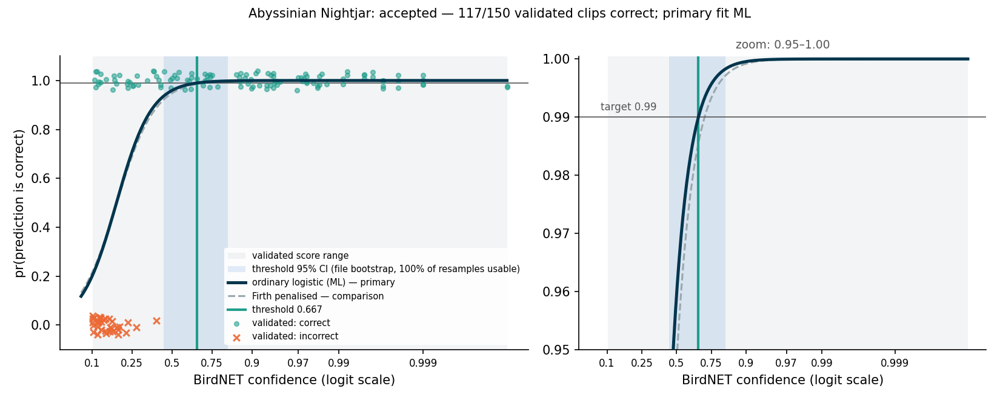
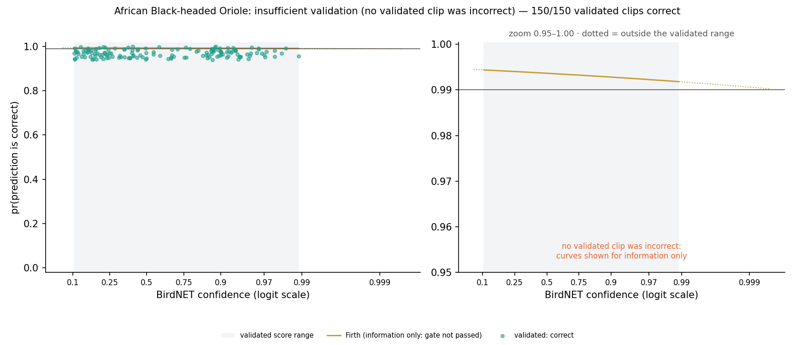
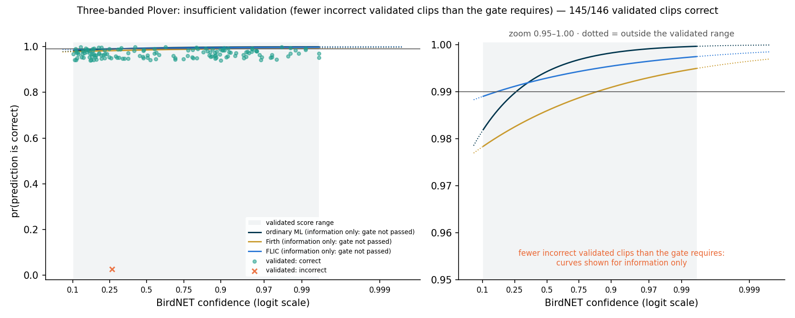
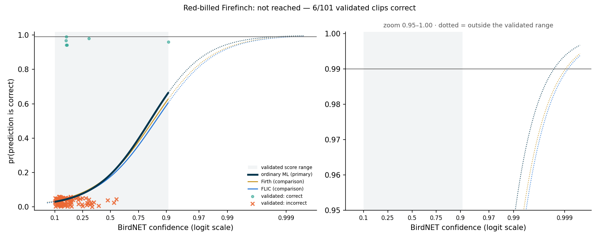

# Challenge 1, Q1: from BirdNET predictions to observations

**Task.** Using a 99% probability-of-correctness cutoff, give every row of `birdnet_predictions.csv` an `observation` label.

**Answer.** [`outputs/birdnet_predictions_with_observations.csv`](outputs/birdnet_predictions_with_observations.csv) contains all 29,491 rows. The 13 source columns are unchanged, byte for byte, and `observation` is added, along with columns that explain each label. **3,460 predictions are observations.** For the other 26,031, `observation` is empty.

| Species | Predictions | Validated clips (correct / incorrect) | Result | Threshold | Observations |
|---|---:|---|---|---:|---:|
| Abyssinian Nightjar | 10,187 | 117 / 33 | **threshold accepted** | **0.666639** | **3,185** (3,147 above the threshold + 38 more confirmed by the ornithologist) |
| African Black-headed Oriole | 18,054 | 150 / 0 | insufficient validation: no errors observed | — | 132, all confirmed by the ornithologist |
| Three-banded Plover | 1,015 | 145 / 1 | insufficient validation: one error | — | 137, all confirmed by the ornithologist |
| Red-billed Firefinch | 235 | 6 / 95 | 99% never reached within the validated scores | — | 6, all confirmed by the ornithologist |

Only one species gets an automatic threshold. That is a finding about the **validation data**, not about BirdNET: a 99% threshold is located by the errors near it, and two of the species have almost none to learn from. The rest of this report explains how I got there, what I decided along the way, and what would change the answer.

Section 10 discusses how closely the analysis follows Wood & Kahl, what the other papers contributed, and the conclusions. The code is in [`src/`](src/), every decision with its evidence is logged in [`docs/challenge1_data_decisions.md`](../docs/challenge1_data_decisions.md) (D-01 to D-14), and the dashboard page **Birds → Thresholds & observations** shows all of it interactively.

---

## 1. The method, and where I kept to the paper

Natural State follows Wood & Kahl (2024). For each species, the ornithologist's verdict (1 = correct, 0 = wrong) is regressed on the logit of the BirdNET confidence:

  logit pr(correct) = β₀ + β₁ · ln(c / (1 − c))

The threshold is the score at which the fitted probability reaches 99%:

  threshold = (ln(0.99 / 0.01) − β₀) / β₁

I kept the paper's method as it is. The estimator is ordinary maximum likelihood, identical to R's `glm(binomial)`; I tested it against statsmodels to 10⁻⁷. The paper is silent on some situations that this dataset contains, and I added safeguards for those. Each safeguard leads to fewer automatic observations, never more. A point-by-point comparison with the paper is in [`docs/challenge1_paper_alignment.md`](../docs/challenge1_paper_alignment.md).

**"99%" means per prediction.** The brief says both "precision ≥ 0.99" and "99% sure that that prediction is correct". The paper defines the threshold per prediction, and so do I: every labelled prediction has a fitted probability of at least 0.99. The set-level reading only needs the *average* of the labelled predictions to reach 0.99. For the Nightjar it would give 0.4316 and 4,355 labels instead of 3,147. I report it but don't use it (D-12).

## 2. Data checks before any fitting

The full checks are on the dashboard (**Data quality**). Five of them affected the analysis:

1. **Duplicate validations (D-01).** Four pairs of Plover clips point to the same single 3-second segment, so the same audio was validated twice. I dropped one clip of each pair, leaving 547 distinct clips. A fifth pair is ambiguous and I kept it; the sensitivity analysis shows it makes no difference.
2. **Linking clips to predictions (D-02).** The two exports name files differently: the predictions round the start time down to the hour. I linked clips on species + recorder + date + hour + score, allowing for the 3-decimal rounding in the validation file names. Of the 547 clips, 476 link to exactly one prediction, 69 tie with another prediction that has the same rounded score, and 2 are not found.
3. **Clustering.** The 551 clips come from 353 audio files and 32 recorders. 93% of the Plover clips come from one recorder (RBS75). The clips are distinct but not independent, so uncertainty is estimated by resampling whole recorders.
4. **Recorder clocks (D-03).** Bird activity suggests that RBS40 and RBS71 run about 3 hours behind, consistent with UTC. This matters only for the time-of-day test in section 6; thresholds use score and verdict only.
5. **Validation design (D-12).** The validation set over-represents high scores: 26% of validated Oriole clips score ≥ 0.9, against 3% of Oriole predictions. That is what the paper's recommended top-up of high-score samples would produce. Choosing clips *by score* does not bias a model of correctness *given* the score, so the curves are fine. But a raw "share correct" over all validated clips would be biased, so I never report one without the model or a score band.

## 3. The decision procedure

```
validated clips ──► link & de-duplicate ──► EVIDENCE GATE ──► fit (ordinary ML) ──► ACCEPT? ──► label
                                             ≥ 5 correct and       Firth only if        valid, increasing,     human verdict,
                                             ≥ 5 incorrect         data are separated   inside validated       else confidence
                                                                                        score range            ≥ threshold
```

- **Evidence gate (D-09).** A species needs at least 5 correct **and** at least 5 incorrect validated clips before a fitted curve may set its threshold.
  - **Why errors matter.** The 99% point lies where errors become rare, so its location is learned from the errors near it.
  - **With 0 errors (Oriole),** ordinary maximum likelihood has no finite answer. Even the penalised (Firth) fit is flat, and its level is set entirely by the penalty.
  - **With 1 error (Plover),** three defensible estimators put the threshold at 0.16, 0.26 or 0.85, which would mean 785, 536 or 100 labels. Remove that single clip and there is no threshold at all.
  - **Why 5.** It is the smallest count at which no single clip decides the answer. The sensitivity analysis also runs k = 1, 3 and 10.
- **Accept (D-05).** The threshold must come from a valid, increasing curve and lie inside the range of validated scores.
  - A threshold above that range would be an extrapolation. That is the Firefinch: its curve reaches 99% only at about 0.998, but its highest validated score, and its highest prediction, is 0.907.
  - If the curve were already above 99% at the lowest validated score, the threshold would be that score, never a point below it.
- **Label (D-10).** If a validated clip links to exactly one prediction, the ornithologist's verdict is the label: confirmed means observation, rejected means not. Every other prediction is an observation when its confidence is at least the species threshold.
  - The exported threshold is rounded up to 6 decimals, and the labels use exactly that value.
  - A Tech implementation of `confidence >= species_threshold` therefore reproduces them exactly. The dashboard re-applies the rule independently and checks this.
- **Flag (D-11).** Predictions from recorders whose validated clips clearly disagree with the curve are flagged for human review. The flag never changes a label.

I arrived at the evidence gate after an independent review of a first version. That version made Firth's estimator primary for rare-error species, and gave the Plover 100 labels on the strength of one error. The review showed that Firth's penalty acts like a second error: it pulls the predicted probabilities down, and so pushes the threshold up. The decision log keeps both versions (D-05 to D-08, then D-09 to D-12), so the change and its reasons are visible.

## 4. Results by species

### Abyssinian Nightjar: threshold 0.666639



- **The curve.** It rises steeply between 0.2 and 0.6. Below 0.3 most validated predictions are wrong; above 0.6 virtually all are right. The 99% point, 0.6666, lies well inside the validated range (0.102–1.0).
- **Labels.** 3,147 of 10,187 predictions (31%) are at or above it. The model expects 99.85% of them to be correct.
- **Model-free check.** All 74 validated clips at or above the threshold were judged correct. The Wilson 95% lower bound on that share is 95.1%. So the "99%" comes from the shape of the logistic curve, and the validation directly supports about 95%. That is the honest strength of the claim.
- **Uncertainty (D-12).** I resampled whole recorders 2,000 times and re-ran the whole procedure each time, gate included.
  - 93% of resamples produce a threshold, with a 95% interval of **0.471–0.835**. The 95% interval for the labelled count is 0 to 4,109 (median 3,123).
  - Every resample without a threshold (7%) leaves out both RBS75 and RBS79. The reverse does not hold: some resamples that leave out both still produce a threshold.
- **Other estimators.** Firth and FLIC put the threshold at 0.709 and 0.707, about 200 fewer labels. The estimators agree closely when both outcomes are plentiful.
- **Review flags.** RBS75 and RBS79 are flagged. All 29 of their validated Nightjar clips are wrong, against 4.4 and 10.9 expected from a curve fitted on the other recorders (p = 0.0026 and 2.5 × 10⁻⁸). Those clips all scored ≤ 0.273, so the validation says nothing about high-scoring Nightjar predictions there. The 9 predictions above the threshold at RBS79 stay observations, with `review_flag` set.
- **A caveat on the gate.** RBS75 and RBS79 hold 29 of the Nightjar's 33 errors. Without them only 4 errors remain, and the Nightjar would not pass the gate, even though its threshold would barely move (0.686, 3,047 labels). The location of the threshold is robust; the amount of evidence behind it is not.

### African Black-headed Oriole: insufficient validation



- **The data.** All 150 validated clips are correct, across scores from 0.104 to 0.989 and 14 recorders. Ordinary maximum likelihood has no finite estimate. Firth's curve is flat (slope −0.06 ± 0.53), so the slope is not identified.
- **What the validation does support.** At least 97.5% correct (Wilson lower bound). A 99% lower bound without any model would need 381 correct clips in a row.
- **Result.** No threshold. The 132 human-confirmed predictions are observations.
- **What I did not do.** Read the flat Firth curve at face value. That would have labelled 17,646 Orioles on the strength of a penalty term, with zero errors to calibrate it.

### Three-banded Plover: insufficient validation



- **The data.** One error in 146 distinct clips: score 0.264, recorder RBS64. The estimators disagree completely: ordinary maximum likelihood 0.261, Firth 0.848, FLIC 0.156.
- **Result.** No threshold. The 137 human-confirmed predictions are observations.
- **What it needs.** More validation, especially from recorders other than RBS75. RBS75 supplies 92% of Plover predictions and 93% of the validated clips.

### Red-billed Firefinch: 99% never reached



- **The data.** 95 of 101 validated clips are wrong. The species passes the gate (6 correct, 95 incorrect), but its curve reaches 99% only at about 0.998, above every score it was validated at (≤ 0.907). At that top score the fitted probability is 0.67.
- **Result.** No threshold. The 6 human-confirmed predictions are observations.

## 5. How robust is this?

The whole procedure was re-run under 14 variants: the documented run plus 13 alternatives (D-12, dashboard **Sensitivity**).

| Choice varied | Effect |
|---|---|
| Treatment of scores of exactly 1: clamp at 5×10⁻⁴, 10⁻⁵ or 10⁻⁶ instead of 10⁻⁴, or drop them | None. The Nightjar threshold changes in the 8th decimal |
| Duplicate handling: also reduce the ambiguous pair, or no de-duplication | None on any decision |
| Gate size k | k = 1 would admit the Plover at 0.261 (536 labels). k = 3: no change. k = 10 also stops the Firefinch, which has no threshold anyway |
| Estimator (Firth or FLIC throughout, with k = 1) | Nightjar ≈ 0.71 (≈ 200 fewer labels). Plover from 0.16 to 0.85 |
| Flagged recorders removed | The Nightjar fails the gate (4 errors left); with k = 1 its threshold is 0.686 |

## 6. Does the curve transfer across recorders and time? (Wood & Kahl's AIC test, D-13)

The paper suggests adding spatial and temporal covariates and comparing models with AIC. All recorders are in one grid, so the spatial unit is the recorder. It enters as a random intercept, fitted by adaptive Gauss–Hermite quadrature, because a plain recorder term diverges for recorders whose clips are all wrong. I also tested time of day (evening vs night) and the week of the season.

For the Nightjar:

- **Recorder differences dominate.** The recorder intercept lowers AIC by about 55. But they are not a normal spread: the recorder SD diverges, because RBS75 and RBS79 behave as if always wrong. So that model can't produce a threshold, for a typical recorder or a new one.
- **The time effects are those two recorders in disguise.** 26 of their 29 validated clips are from the evening. With recorders in the model, the evening term adds almost nothing (ΔAIC 0.6). Among the other recorders, the week has no effect.
- **A hypothesis worth testing.** All 4 remaining Nightjar errors are evening clips, and none of 68 night clips is wrong. Dusk may be when other species are mistaken for Nightjars. Four errors can't settle it.

No covariate model is both better and usable for recorders that haven't been validated, so the labels keep the pooled curve. Recorder problems are handled by the review flags, and on the platform by a recorder acceptance check (see the Tech handover).

## 7. Limitations

- **Recall is unknown.** The files hold predictions above BirdNET's minimum score and verdicts on some of them; nothing records the vocalisations BirdNET missed. Observations are high-precision by design. **A missing observation is not evidence of absence**, so dashboards should not present it as such.
- **The 99% is model-based.** Direct validation supports about 95% for the Nightjar (Wilson lower bound).
- **The thresholds belong to this deployment.** They apply to these recorders, this season, this hardware and BirdNET v2.4. Wood & Kahl are explicit that scores don't transfer across equipment or settings.
- **Some inputs rest on inference, not metadata:** the clip linkage (69 ties), the recorder clocks (D-03) and the validation protocol are all inferred.
- **`p_correct` is exported only where the curve is identified** (Nightjar, Firefinch). It is the input that false-positive occupancy models need. The Oriole and Plover rows have no `p_correct`, rather than a number driven by an artefact.

## 8. What would change the answer: recommended validation

| Species | What to validate | Why |
|---|---|---|
| African Black-headed Oriole | A further random sample across scores and recorders, a few hundred clips | Either errors appear and the curve becomes estimable, or the share correct climbs high enough to support a threshold. 381 correct in a row would give a model-free 99% lower bound |
| Three-banded Plover | Random clips across scores from recorders other than RBS75 | One error can't locate a threshold, and RBS75 dominates both the predictions and the validation |
| Abyssinian Nightjar | Random clips from recorders other than RBS75/RBS79, including evening clips | So the threshold stands without the two flagged recorders, and to test the dusk hypothesis |
| Red-billed Firefinch | All 8 predictions scoring ≥ 0.5, and 21 ≥ 0.3 | Few enough to review by hand. This species is better served by review than by a threshold |
| Every new recorder | A small random sample per species before automatic labelling | To catch RBS75/RBS79-type failures early (recorder acceptance check) |

Sampling should stay random within score bands, the paper's approach, and should never target likely errors. Targeting errors would bias the curve.

## 9. Confirmation items for Natural State

These are assumptions the analysis runs on. None of them blocks the result. Each one has a working assumption, which is what the code and labels use today, and a statement of what would change if Natural State confirms something different. All are currently **to confirm**.

| ID | To confirm | Working assumption used here | If it turns out differently |
|---|---|---|---|
| **C-1** | **How validation clips were sampled:** random, random within score bands, a high-score top-up; with or without replacement | Chosen at random within score ranges, with a top-up of high scores, as Wood & Kahl recommend. This fits the validated score distribution (D-12). So the curve of correctness *given* the score is unbiased. The 4 duplicate pairs are accidental re-draws and are removed (D-01) | If clips were chosen for any reason other than their score (a recorder, a time, or because they looked wrong), the curves may be biased and should be refitted with that design in mind. If sampling was without replacement, the duplicate pairs need another explanation |
| **C-2** | **BirdNET run settings:** model version, minimum score, sensitivity | v2.4, as stated in the validation file; minimum score 0.1, the lowest prediction is exactly 0.1000; default sensitivity | Sensitivity rescales BirdNET's logit scores but not thresholds expressed as confidence scores, so the labels would not change. Thresholds do not carry over to runs with a different version or settings |
| **C-3** | **Recorder clocks:** RBS40 and RBS71 about 3 h behind local time, i.e. on UTC | Inferred from bird activity (D-03). Used only for the evening term of the covariate test | Thresholds and labels are unaffected. Only the time-of-day test (D-13) changes, through 4 Nightjar clips at RBS40 |
| **C-4** | **What the wrong Nightjar detections at RBS75 and RBS79 are:** another species, noise, a recorder fault | Site-specific false positives. Their predictions are flagged for review, not removed (D-04, D-11) | If they are another species calling there (RBS75 also produces 92% of the Plover predictions), high-scoring Nightjar predictions at those recorders may be wrong too. The 9 flagged predictions above the threshold should then count as unconfirmed until validated |
| **C-5** | **The meaning of "99%":** per prediction, or the precision of the labelled set | Per prediction, as in Wood & Kahl. Nightjar threshold 0.666639, 3,147 predictions above it | Set-level precision gives the Nightjar 0.4316 and 4,355 predictions. The pipeline already computes both (D-12) |
| **C-6** | **How the two exports name the same audio:** the predictions export rounds the file start down to the hour, and the validation file name carries a 3-decimal score and a clip index | Clips are linked on species + recorder + date + hour + score (D-02): 476 link to one prediction, 69 tie with another, 2 are not found | If the naming means something else, a few human verdicts could be attached to the wrong prediction, or not attached at all. A stable prediction id in both exports removes the issue (Q2, section 8) |
| **C-7** | **Outcome coding:** `outcome = 1` means BirdNET's species identification was correct | As stated. It is consistent with the data: the share of correct clips rises with score for every species with errors (Nightjar 0.49 below 0.5 vs 1.00 above) | Everything would invert. This is a sanity check rather than a real doubt |

## 10. Discussion and conclusions

### Did we follow Wood & Kahl (2024)?

**Yes, on the method itself.** The labels come from the paper's procedure, unchanged:

- one curve per species
- ordinary logistic regression of the verdict on the logit-transformed score (the paper's `glm`, and the logit its text recommends)
- the threshold solved from the fitted curve at p = 0.99

We also ran the paper's suggested test of whether the curve transfers across space and time, comparing covariate models by AIC (section 6). We disclose error rates, and export per-prediction probabilities for occupancy models, as the paper advises.

**Where the paper is silent, we added safeguards.** The model-side ones make the automatic labels more conservative, never more permissive:

- the evidence gate, for species with zero or one error
- Firth only as a fallback for separated data
- no extrapolation outside the validated scores, a stricter reading of the paper's "range of conditions" warning
- recorder review flags

**One addition works the other way, by design: human verdicts are kept as labels.** This adds 313 observations that no threshold supports (Oriole 132, Plover 137, Nightjar 38, Firefinch 6), each backed by direct confirmation rather than by the model.

**What we could not do as the paper describes:**

- **Design the validation sample.** We used the clips provided. Their score distribution fits the paper's recommended high-score top-up, but that is unconfirmed (C-1).
- **Report recall.** The paper says precision, recall and ROC still matter. The data hold no record of missed vocalisations, so recall cannot be computed. Observations should be read as high-precision, not as a complete count.

The full point-by-point comparison is in [`docs/challenge1_paper_alignment.md`](../docs/challenge1_paper_alignment.md).

### How the other methods informed this analysis

The dashboard's **Methodology** page reviews five related papers. None of them replaces Wood & Kahl, which the brief prescribes. Each one shaped a specific part of the work (D-14):

| Paper | What it offers | How it was used here |
|---|---|---|
| **Tseng et al. 2025** | Thresholds based on the precision of the whole set of kept predictions, rather than per prediction | **Reported as the alternative reading of "99%"** (C-5). Set-level precision would give the Nightjar a threshold of 0.4316 and 4,355 labels, against 0.6666 and 3,147: about 38% more observations, each individually less certain. The per-prediction rule is kept because it is the paper's definition and the brief's wording ("99% sure that that prediction is correct"). Which standard Natural State wants is a policy choice |
| **Schwinger et al. 2025** | Calibration diagnostics: Platt scaling, reliability diagrams | **Used as a check.** Wood & Kahl's curve *is* Platt scaling. Calibration by score band (observed share correct vs fitted probability) confirms the Nightjar curve fits across the range. Their finding that calibration varies across datasets supports recalibrating per species and per deployment |
| **Thompson et al. 2025** | Mixed models that pool species curves, so rarely validated species borrow strength from the others | **Considered and not adopted for labels.** It would give the Oriole and Plover a curve, but only by assuming they behave like the other species, which their own data cannot confirm and which cuts against Wood & Kahl's central point that scores do not transfer between species. With four species, one of them the near-useless Firefinch, the pooled curve would mostly reflect the pooling assumption. It becomes attractive on the platform once many species are validated: a new species would start from the community curve and move away from it as evidence accumulates |
| **Navine et al. 2024** | Threshold-free estimates of call density (the share of audio windows containing the species) | **A different product, not clip labels.** It needs no errors, so it suits exactly the species that cannot be thresholded here, such as the Oriole. It is recommended to the Tech team as a future measure of vocal activity, and its validation design (quantile bins) is a good model for future validation rounds |
| **Clare et al. 2021** | Occupancy models that account for false positives | **Downstream.** A 99% threshold reduces false positives but does not remove them, and ignoring them biases occupancy estimates. That is why `p_correct` is exported per prediction, and why the validated clips should be kept as confirmation data |

### Conclusions

1. **The answer to Q1.** 3,460 of the 29,491 predictions are observations: 3,097 above the Nightjar's 99% threshold (0.666639), and 363 confirmed directly by the ornithologist. Every row carries its label, the reason for it, and where applicable its probability of being correct.
2. **Only one of the four species can be thresholded at 99% with this validation set.** That is a statement about the evidence, not about BirdNET. A 99% threshold is located by the errors near it.
   - The Oriole (0 errors in 150 clips) and the Plover (1 in 146) cannot locate one.
   - The Firefinch's curve never reaches 99% within the scores that were validated.
3. **The Nightjar's 99% is a model-based figure.** Its location is robust to the estimator, de-duplication, the treatment of scores of exactly 1, and the removal of the two problem recorders. But direct validation supports about 95%: all 74 validated clips above the threshold are correct, and the Wilson lower bound is 95.1%.
4. **Recorders matter more than time.** RBS75 and RBS79 behave as if their Nightjar predictions were always wrong. They are flagged rather than removed. Every new recorder should pass a small acceptance check before its predictions are labelled automatically. The apparent evening effect is those two recorders in disguise, though dusk remains a hypothesis worth testing.
5. **The decisions that move the answer are the gate and the estimator, and only for species with one error or fewer.** Data-handling choices change nothing. That sensitivity is the reason for the evidence gate.
6. **The way forward is more validation, designed as Wood & Kahl recommend** (section 8): random within score bands, never targeted at errors, and spread across recorders.
7. **The procedure is ready to automate.** The `ns_observations` package (Q2) runs the same decision rules as this analysis and reproduces these numbers exactly.
8. **Among the alternatives in the literature,** set-level precision (Tseng) is the one real policy alternative: it is a choice for Natural State (C-5). Partial pooling (Thompson) belongs on the platform once many species are validated. Call density (Navine) and false-positive occupancy models (Clare) are the natural next uses of these outputs.
