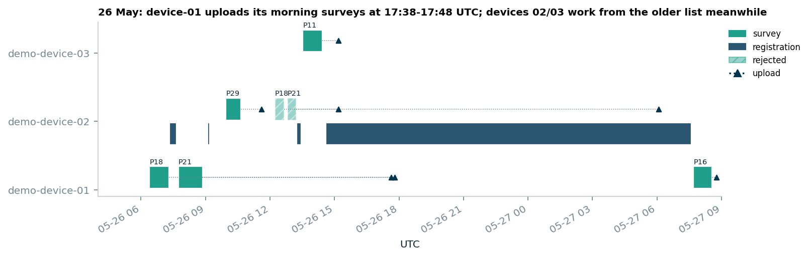
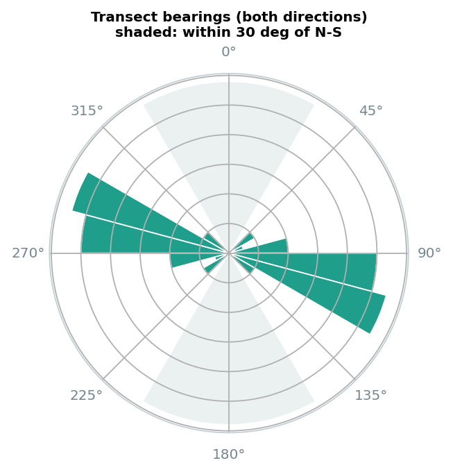
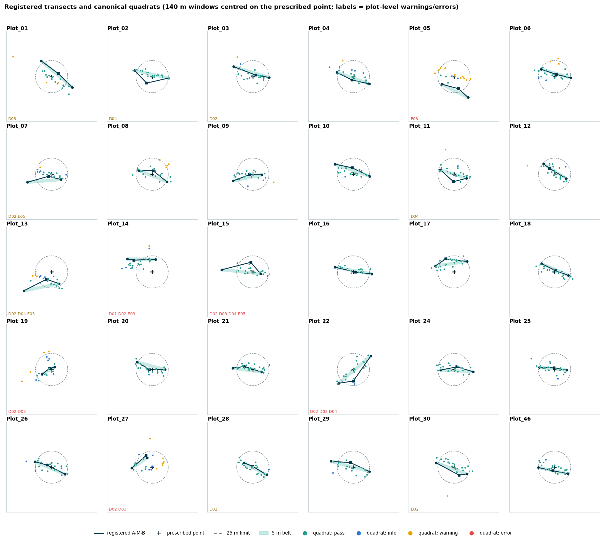
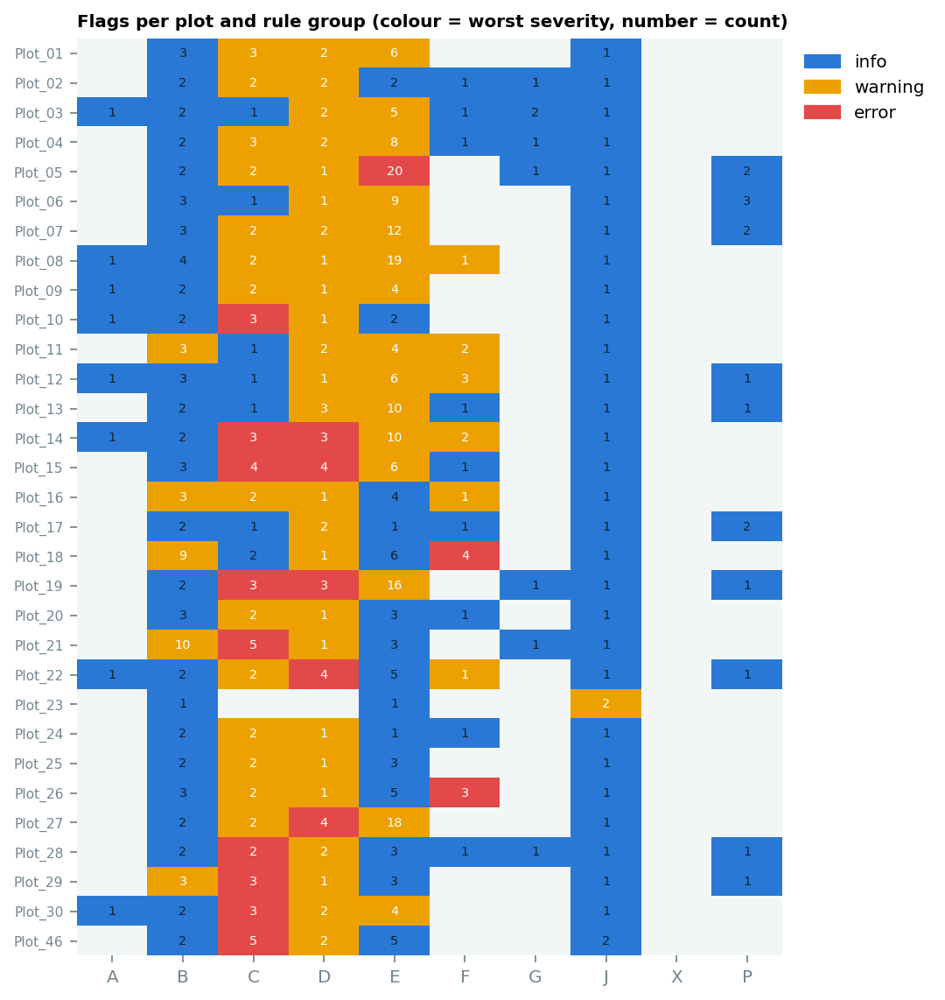
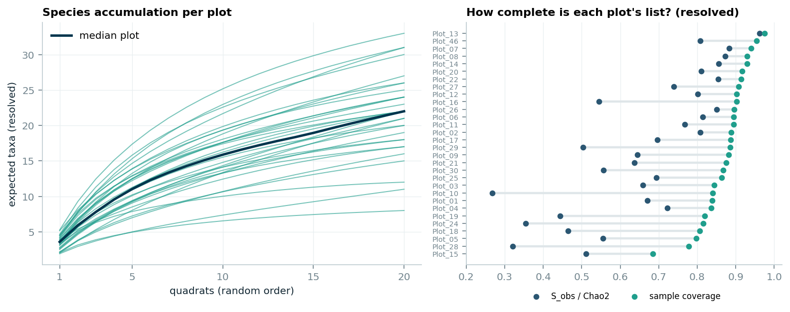
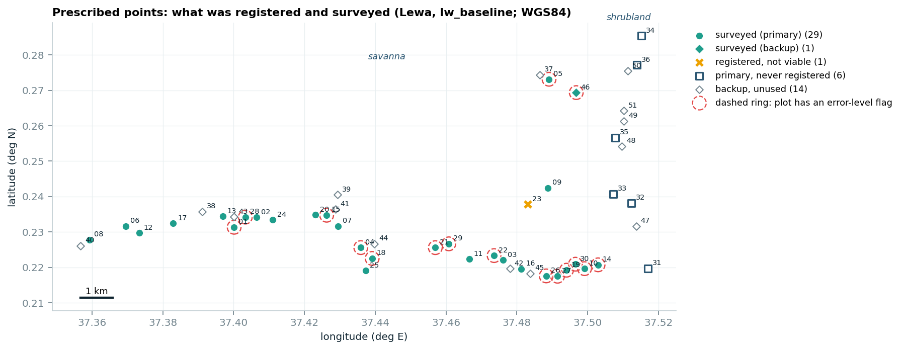

# Herbaceous vegetation survey: data quality report

**Project:** Savanna Monitoring Pilot, Lewa (survey `savmon|lw|herbs|ho`, replicate `lw_baseline`)
**Data:** ODK exports, entity lists and forms as provided. **Nothing was changed or fixed:** every problem is a flag that points to the source row.
**Prepared by:** Carlos Hoyos · run `qa-3272d4edb98c6514` · reproducible with `python challenge2/src/run_challenge2.py`

---

## Summary

The 30 surveyed plots are complete and internally consistent at the record level:

- every survey has its 20 quadrats;
- every photo and attachment is present;
- every reference resolves;
- every GPS point meets the 5 m accuracy requirement.

The data can support **herbaceous richness estimates for the savanna stratum**, with the caveats below. The problems that matter for richness and diversity sit elsewhere: in **what was sampled**, **where transects are**, and **how taxa are named**.

**Issues that affect richness and diversity, in order of importance:**

1. **The shrubland stratum was not sampled.** None of its 6 primary points was registered (J01), so the project cannot report herbaceous richness for shrubland. In the savanna stratum, 29 of 30 primary points were surveyed, plus 1 backup.
2. **Taxonomy needs curation before diversity metrics are computed.**
   - 23 taxon names are probably misspelled (F03), confirmed against the GBIF backbone: "Crotolaria", "Ipomea", "Oldenladia", "Duosperma cretanum", "Polygalaerioptera", among others.
   - The curation table introduces one new typo ("Hibiscuc") and keeps others (F13).
   - Several provisional ids are one species (F08): "Ipomea dichroa" is 4 ids.
   - 23 unknowns remain unresolved, and they make up 15% of the records (F07).
   - Raw richness is 132 taxa; after Natural State's own curation it is 115.
3. **20 of 90 identified taxa have no GBIF record in Kenya**, but hundreds in southern Africa (F10): Pogonarthria fleckii, Pechuel-loeschea leubnitziae, Erlangea misera, Aristida scabrivalvis, and others. Either they are misidentifications or the species list comes from another region. The list also offers "Mokoro", an Okavango dugout canoe, as transport (confirmation item C-7).
4. **Species may have been lost in 10 quadrats.** They are marked "additional species present" but have no species rows (C04). One further additional-species row has no taxon (C08).
5. **Some transects are not where the registration says** (E03, D01–D04):
   - Plot 05's quadrats lie 20 m to one side of the registered line, beyond GPS error.
   - Plot 14's midpoint is 33.6 m from the prescribed point; the SOP allows 25 m.
   - Plots 19 and 27 were registered as 23 m and 29 m transects instead of 50 m.
   - Plots 07 and 15 cover only part of their transect.
6. **All 30 transects run roughly east–west** (49–89° off north–south), and **all 32 surveys walk out-and-back**. The SOP asks for a north–south layout and pairs at each 5 m mark. This is systematic, so it reads as a local practice, not as field errors (D05, E13; C-3).
7. **Two plots were surveyed twice, with two devices claiming the same new-species ids.**
   - Device-01 uploaded its morning surveys of Plots 18 and 21 about 9–10 h late.
   - Devices 02 and 03 therefore worked from an outdated species list, so new taxa from different plots received the same provisional ids (B06, B10).
   - Natural State rejected the two repeat submissions, but their entity updates remain (F09, K03).
8. **The form's own end-of-survey check is wrong in 23 of 32 surveys** (C07, K02). The "quadrats with species" count misses list species because of a path error in the form, so the plausibility check the SOP relies on (step 13) misleads the team.

**Counts:** 91 rules were evaluated on 24,647 rule × entity combinations. The result was 640 failures:

| Severity | Failures | Meaning |
|---|---:|---|
| Error | 24 | Violates a documented requirement or prevents reliable interpretation |
| Warning | 224 | Needs review |
| Info | 392 | Context |

A further 21 combinations could not be checked. Every check that passed is listed with its count in Appendix A, so "not flagged" can be told apart from "not checked".

### How to read this report

- **Rule ids** (B10, F03, …) point to the catalogue in Appendix A and to `challenge2/rules/rules.yaml`. Each rule records its source: an SOP step, an ODK form row, an entity list, or "judgement" where the threshold is ours.
- **Severity:**
  - **error**: violates a documented requirement or prevents reliable interpretation;
  - **warning**: plausible, but needs review;
  - **info**: context.
- **Raw vs resolved taxa:**
  - **Raw** is the taxon as recorded.
  - **Resolved** follows Natural State's curation table (`species_extra_ids`): merges and exclusions are applied, spellings are never changed (V-02).
- **Canonical survey:** for the two plots surveyed twice, the accepted submission counts. The rejected one is kept for the repeatability estimate (V-01).
- **GPS-aware tests:** distances are compared with the reported GPS accuracy, so ordinary GPS noise is not flagged (V-04).
- **Further reading:** decisions V-01 to V-11, differences from the earlier exploration, and new findings are in [`docs/challenge2_decisions.md`](../docs/challenge2_decisions.md). Every flag, with its source row, is in [`outputs/qa_flags.csv`](outputs/qa_flags.csv).

---

## (a) Survey-level summary

The survey is the herbaceous survey entity of the Lewa baseline replicate as a whole. The table below covers all 32 submissions to it.

<!-- table:survey_overview -->
|  | value |
|---|---|
| Survey entity | `savmon\|lw\|herbs\|ho` (replicate `lw_baseline`) |
| Field days | 9 (2026-05-19 to 2026-05-27) |
| Prescribed points | 36 primary + 15 backup |
| Plots registered / viable / surveyed | 31 / 30 / 30 |
| Submissions (rejected) / canonical surveys | 32 (2) / 30 |
| Quadrats (canonical) | 600 |
| Occurrences (canonical) | 2,093 |
| Taxa: raw / resolved / resolved and identified | 132 / 115 / 92 |
| Devices / recorders | 3 / 2 |
| Flags: error / warning / info | 24 / 224 / 392 |
<!-- /table -->

### What is in good order (checks that passed everywhere)

| Area | Checks that passed | Rules |
|---|---|---|
| Structure and joins | Every survey has exactly 20 quadrats, numbered 1–20; no orphan rows; no duplicate keys | A01–A04 |
| References | Every species, team member, transport, survey, plot and ecosystem reference resolves; all 947 list picks are herbaceous species | A05, A06 |
| Evidence | Attachments present = expected for all 63 submissions; no photo file used twice (880 files) | A08, E11 |
| Timing | Every quadrat photo falls inside its survey window; no upload before its form ended; no team member on two overlapping visits; no implausible travel speed between visits | E08, B06, B08, B09 |
| GPS | All points meet the form's 5 m accuracy limit | D06, E01 |
| Form rules | No constraint, required-field or relevance rule of either form is broken (canonical names, confirmation, macro photos, registration metadata) | C01–C03, C05, C06, C08–C13, C15, C16 |
| Entity state | Every provisional species entity holds exactly what its last submission wrote; the provisional index sequence is unbroken across accepted submissions | X01, F14 |
| Plot links | Every survey points to a registered, viable plot of the herbaceous survey | B03, D11 |

### Issues at survey level

- **Duplicate surveys and review state** (B01, B02, V-01).
  - Plots 18 and 21 have two submissions each, both from 26 May.
  - They are genuine repeat visits, not copies: photos about 5 h later, 25–26 min against 53–68 min, and different species.
  - Natural State rejected the device-02 repeats, so the device-01 surveys are canonical.
- **How the slot collision happened** (B06, B10, F09, K03; figure below).
  - Device-01 finished Plots 18 and 21 by 10:51 EAT on 26 May but uploaded them only at 19:38–19:48 EAT.
  - Meanwhile devices 02 and 03 surveyed Plots 29, 18, 21 and 11. Each started with 99 active provisional species instead of 102.
  - So the first new taxa on device-02 took ids herb_100–102, which device-01 had already used on other plants.
  - Rejecting the repeat submissions did not undo their entity updates: herb_101 and herb_102 were last written by the rejected Plot 21 survey.
  - **Process fix:** upload at the end of every survey and refresh entity lists before the next one. ODK Central does not roll back entity writes when a submission is rejected.

- **Form calculation bug** (C07, K02).
  - In 23 of 32 surveys the stored "quadrats with species" differs from the recomputed value; Plot 14 stores 11 where the true count is 20.
  - In all 23 the stored value equals exactly what the form expression computes as written: it refers to `selected_herb_species_uuids` relative to the quadrat, but the field sits inside the `herb_species` group, so list species are never counted.
  - **Fix:** use `herb_species/selected_herb_species_uuids` in the form.
- **Durations** (B05). The median survey took 62 min. Four surveys fall outside 0.5–2.5 × the median:
  - the first two surveys (Plot 08: 236 min; Plot 12: 165 min), probably learning days;
  - the two 25–26 min repeat visits.

  Two canonical surveys are short and also species-poor: Plot 46 (33 min, 8 taxa) and Plot 24 (38 min, 11 taxa, 14 all-unknown quadrats). They deserve a look, although they stay inside the rule's threshold.
- **Registrations** (B05, E12).
  - Plot 16's registration form was open for 17 h, from 26 May 16:35 to 27 May 09:36 EAT, so its points and photos may come from two visits.
  - The non-viable Plot 23 was confirmed 157 m from its prescribed point, consistent with "on private property".
  - The confirmation geopoint is missing for the three device-02 surveys and 16 registrations (`could_not_check`).
- **Time zone** (B12). All timestamps are labelled +02:00, but Lewa is on +03:00 (EAT). The instants are correct; wall-clock times read off the label are 1 h behind (V-07; C-8).
- **Recorders** (G03). Grace recorded 25 of the 30 canonical surveys and Sam 5. Four of the six team members never recorded. Recorder effects on identification cannot be separated from plot effects.
- **Labels and form design** (C14, X01, K01, K04).
  - Surveys store replicate `lw_baseline`; the form file computes `LW_baseline`; the centroid list says `baseline`.
  - The SOP asks for `Genus_species`, but the form and all 45 typed names use spaces.
  - Macro photos are capped at 4,096–4,100 pixels: copy-paste drift in the form.
  - The quadrat GPS warns only at 10 m.
  - The registration form lets a plot be registered twice.
  - One registration field name is used twice, and two soil choices contain spaces.

<b>All 32 submissions</b> (E/W/I = error / warning / info flags)

<!-- table:submissions -->
| plot | start (EAT) | device | recorder | review | canonical | min | upload h | taxa (resolved) | E/W/I | failed rules |
|---|---|---|---|---|---|---:|---:|---:|---|---|
| Plot_08 | 19 May 11:42 | d01 | Sam | not reviewed | yes | 236 | 4.0 | 26 | 0/6/18 | B05 B12 C07 C14 E02 E03 E04 E07 E13 F01 |
| Plot_12 | 20 May 09:30 | d01 | Sam | not reviewed | yes | 165 | 6.9 | 33 | 0/4/8 | B05 B12 C14 E02 E04 E07 E13 F05 |
| Plot_22 | 20 May 13:53 | d01 | Sam | not reviewed | yes | 73 | 4.8 | 20 | 0/2/7 | B12 C07 C14 E02 E04 E07 E13 F05 |
| Plot_03 | 20 May 16:24 | d01 | Sam | not reviewed | yes | 59 | 3.1 | 15 | 0/2/8 | B12 C14 E02 E04 E09 E13 F11 G02 |
| Plot_30 | 21 May 09:10 | d02 | Grace | not reviewed | yes | 101 | 0.4 | 24 | 1/3/4 | B12 C04 C07 C14 E02 E03 E04 E13 |
| Plot_10 | 21 May 11:29 | d01 | Grace | not reviewed | yes | 63 | 2.0 | 21 | 1/1/4 | B12 C04 C07 C14 E02 E13 |
| Plot_14 | 21 May 13:03 | d01 | Grace | not reviewed | yes | 58 | 0.8 | 17 | 1/5/9 | B12 C04 C07 C14 E02 E03 E04 E13 F02 |
| Plot_09 | 21 May 14:50 | d01 | Grace | not reviewed | yes | 82 | 0.6 | 26 | 0/2/5 | B12 C07 C14 E02 E04 E07 E13 |
| Plot_05 | 22 May 09:27 | d01 | Grace | not reviewed | yes | 102 | 1.0 | 16 | 1/14/9 | B12 C07 C14 E02 E03 E04 E13 G02 |
| Plot_26 | 22 May 12:05 | d01 | Grace | not reviewed | yes | 110 | 0.1 | 22 | 2/1/8 | B12 C07 C14 E02 E04 E07 E13 F06 F11 |
| Plot_27 | 22 May 14:42 | d01 | Grace | not reviewed | yes | 66 | 0.4 | 22 | 0/8/13 | B12 C07 C14 E02 E03 E04 E07 E13 |
| Plot_19 | 22 May 16:13 | d01 | Grace | not reviewed | yes | 60 | 0.5 | 19 | 1/7/13 | B12 C04 C07 C14 E02 E04 E07 E13 G02 |
| Plot_46 | 22 May 17:41 | d01 | Grace | not reviewed | yes | 33 | 2.2 | 8 | 3/1/7 | B12 C04 C07 C14 E02 E07 E13 |
| Plot_06 | 23 May 09:37 | d01 | Grace | not reviewed | yes | 92 | 0.5 | 24 | 0/5/6 | B12 C14 E02 E04 E13 |
| Plot_17 | 23 May 11:36 | d01 | Grace | not reviewed | yes | 44 | 0.5 | 22 | 0/0/4 | B12 C14 E13 F11 |
| Plot_13 | 23 May 12:46 | d01 | Grace | not reviewed | yes | 70 | 0.0 | 12 | 0/5/8 | B12 C14 E02 E03 E04 E13 F11 |
| Plot_01 | 23 May 15:03 | d01 | Grace | not reviewed | yes | 70 | 0.5 | 31 | 0/5/4 | B12 C07 C14 E02 E03 E06 E13 |
| Plot_28 | 23 May 16:40 | d01 | Grace | not reviewed | yes | 64 | 1.5 | 22 | 0/0/7 | B12 C14 E04 E07 E13 F11 G02 |
| Plot_02 | 24 May 10:06 | d01 | Grace | not reviewed | yes | 100 | 0.3 | 18 | 0/1/6 | B12 C07 C14 E07 E13 F11 G02 |
| Plot_24 | 24 May 12:05 | d01 | Grace | not reviewed | yes | 38 | 0.1 | 11 | 0/1/4 | B12 C07 C14 E13 F11 |
| Plot_20 | 24 May 13:09 | d01 | Grace | not reviewed | yes | 54 | 0.5 | 17 | 0/1/6 | B12 C07 C14 E02 E03 E13 F11 |
| Plot_15 | 24 May 15:00 | d01 | Grace | not reviewed | yes | 60 | 0.7 | 21 | 1/3/7 | B12 C04 C07 C14 E02 E05 E07 E13 F11 |
| Plot_07 | 24 May 16:38 | d01 | Grace | not reviewed | yes | 56 | 3.7 | 18 | 0/3/12 | B12 C07 C14 E02 E03 E05 E07 E13 |
| Plot_04 | 25 May 15:06 | d01 | Grace | not reviewed | yes | 56 | 0.1 | 20 | 0/3/10 | B12 C07 C14 E02 E04 E07 E13 F11 G02 |
| Plot_25 | 25 May 16:20 | d01 | Grace | not reviewed | yes | 63 | 0.1 | 31 | 0/1/5 | B12 C07 C14 E02 E13 |
| Plot_18 | 26 May 09:23 | d01 | Grace | not reviewed | yes | 54 | 10.4 | 27 | 1/1/5 | B06 B12 C14 E02 E13 F05 F06 |
| Plot_21 | 26 May 10:44 | d01 | Grace | not reviewed | yes | 68 | 8.9 | 30 | 0/1/5 | B06 B12 C07 C14 E02 E13 |
| Plot_29 | 26 May 12:57 | d02 | Sam | not reviewed | yes | 42 | 0.9 | 24 | 1/2/5 | B10 B12 C04 C07 C14 E02 E04 E13 |
| Plot_18 | 26 May 15:13 | d02 | Grace | rejected | no | 26 | 2.5 | 24 | 1/4/6 | B01 B05 B10 B12 C14 E02 E04 E13 F05 F06 |
| Plot_21 | 26 May 15:48 | d02 | Sam | rejected | no | 24 | 16.8 | 30 | 1/4/4 | B01 B05 B06 B10 B12 C04 C07 C14 E13 |
| Plot_11 | 26 May 16:31 | d03 | Grace | not reviewed | yes | 54 | 0.8 | 25 | 0/4/5 | B10 B12 C14 E02 E04 E13 F05 F11 |
| Plot_16 | 27 May 10:41 | d01 | Grace | not reviewed | yes | 51 | 0.2 | 23 | 0/2/6 | B12 C07 C14 E07 E13 F01 |
<!-- /table -->

---

## (b) Plot-level summary

### Registration geometry

- **Orientation** (D05). All 30 registered transects run 49–89° off north–south; the SOP asks for north–south, with rotation only for obstacles. Because the deviation is universal, it is treated as a protocol question (C-3), not 30 field errors.

  

- **Midpoint offset** (D01).
  - Plot 14's midpoint is 33.6 m from the prescribed point, beyond the SOP's 25 m even allowing for GPS error.
  - Plots 17 (23.9 m) and 27 (20.3 m) are within 5 m of the limit.
- **Transect shape** (D02–D04), tested against GPS error.
  - Plots 19 and 27 are far too short: 22.6 m and 28.6 m against 50 m.
  - Plots 01, 15 and 22 are too long: 60–66 m.
  - Plots 02, 11, 13, 15 and 22 are bent, with the midpoint 10–16 m off the A–B line.
  - Ten plots have a half-transect clearly unequal to 25 m.
- **Stratum** (D08). Plot 04 is recorded as "Forest" in the savanna stratum, and its canopy height (10 m) is the tallest in the data. The SOP allows an obvious stratum mismatch to justify non-viability (C-9).
- **Backup** (D09, D10, J02). Plot 23 (non-viable: "On private property") was replaced by backup Plot 46, 3.8 km away, although Plot 42 was 2.1 km away. The backup-selection rule is not documented (C-2).
- **Dominant woody species** (F12). Plot 14 records "Vachellia xanthophloea" as an *unknown* dominant woody species. A named species belongs in the known-species field.

### Quadrat positions and timing

The grid below shows each registered transect: the A–M–B line, the 5 m belt, the prescribed point and the 25 m limit. On top are its canonical quadrats, coloured by their worst position flag.

- **Whole transects offset or rotated** (E03).
  - Plot 05's quadrats sit 19.9 m to one side of the registered line (z = 3.5): error.
  - Plots 13 and 14 were walked 34° and 31° from their registered line: warning.
  - Plots 01, 07, 08, 20, 27 and 30 are offset 5–10 m, which is still within GPS error: info.
- **Coverage** (E05). The quadrats of Plots 15 and 07 cover only 62% and 67% of the registered transect, mostly the B half.
- **Single quadrats** (E02, E04, E06).
  - 18 quadrats lie more than 25 m from their registered segment; the furthest are Plot 01 q18 (44 m) and Plot 30 q20 (42 m).
  - 29 quadrats lie well off their own survey's line.
  - Plot 01's quadrats 6 and 14 have identical coordinates, so a fix was probably not re-recorded.
- **Altitude** (E07). Altitude glitches appear in Plot 08 (q13–16, about +95 m), Plot 22 (q15, −42 m), and runs of ±20–30 m in Plots 12, 19 and 27. These are a GPS quality indicator only.
- **Photo order** (E09). Plot 03's quadrat 13 photo was taken 16 min before quadrat 12's.
- **Walking order** (E13). All 32 surveys walk out-and-back (correlation with that pattern ≈ 0.95), not the SOP's pairs. The spatial design is equivalent, and no position check assumes the SOP order (V-11).

### Species records

- **Possibly lost species** (C04). In 10 quadrats additional species are declared present but no rows exist: Plots 46 (×3), 10, 14, 15, 19, 30, and the rejected Plot 21 and canonical Plot 29.
- **Empty occurrence** (C08). Plot 28, quadrat 6 has a "reuse missing species" row with no species selected.
- **Same taxon twice in a quadrat** (F05). Seven raw duplicates, in Plots 11, 12 (×3), 18 (×2, one rejected) and 22.
- **Identification burden** (F11).
  - 132 of 600 canonical quadrats (22%) were flagged "all unknown / unidentifiable"; Plots 03 and 24 have 14 each.
  - Unresolved unknowns are 15% of canonical records; in Plot 03 they are 58%.
- **Quadrats without herbs** (G02). There are 7. They are valid zeros and count as sampled quadrats (V-06).

### Taxonomy

| Issue | What we found | Rules |
|---|---|---|
| Misspelled names | 23 names: Crotolaria (→ Crotalaria, 5 species), Ipomea (→ Ipomoea, 4), Oldenladia, Brachiara, Zornia glochidiala, Phyllanthus pantandrus, Macrotalyma, Cenchrus bifloris, Tragus racemosa, Duosperma cretanum, Leucas tettenesis, Polygalaerioptera; Abitulum ramosum, Jacquemontia tannifolia, Justicia divaricata and Melosperma bracteatum have no species-level match in GBIF | F03 |
| Curation table | Introduces a typo (Hibiscus sidiformis → "Hibiscuc"); keeps 10 field misspellings; merges and exclusions exist only in free-text notes; label ≠ number for herb_039 and herb_072 | F13 |
| Typed as "missing" but on the list | Pechuel-loeschea leubnitziae. After curation, 7 more provisional taxa turn out to be list species (Chloris virgata, Cenchrus ciliaris, …); they merge in the resolved layer | F02 |
| One species, two entities | Aristida scabrivalvis (herb_040, herb_067); Justicia divaricata (herb_059, herb_104, the second with a trailing space) | F04, F01 |
| Several ids, one species | Ipomea dichroa (4 ids), Crotolaria pisicarpa (2), Evolvulus alsinoides, Tephrosia purpurea, Rhynchosia minima | F08 |
| Woody taxa | herb_100 (duplicate of wood_005) and herb_071 (Rhus tenuinervis), both "below 40 cm, exclude": 3 canonical records, excluded in the resolved layer | F06, V-03 |
| Range | 20 of 90 identified taxa have no GBIF record in Kenya but many in southern Africa | F10 |

### Plots at a glance

<b>All registered plots</b> (offset = midpoint to prescribed point; coverage = sample coverage of the resolved species list)

<!-- table:plots -->
| plot | status | viable | offset m | A-B m | off N-S deg | taxa raw / resolved | all-unknown quadrats | coverage | E/W/I | failed rules |
|---|---|---|---:|---:|---:|---|---:|---:|---|---|
| Plot_01 | primary | yes | 11.4 | 63.2 | 49 | 31 / 31 | 3 | 0.839 | 0/7/6 | B05 B12 C07 C14 D03 D05 E02 E03 E06 E13 |
| Plot_02 | primary | yes | 13.3 | 53.8 | 77 | 18 / 18 | 7 | 0.888 | 0/3/7 | B12 C07 C14 D04 D05 E07 E13 F11 G02 |
| Plot_03 | primary | yes | 5.3 | 57.5 | 73 | 15 / 15 | 14 | 0.844 | 0/4/10 | A10 B12 C14 D02 D05 E02 E04 E09 E13 F11 G02 |
| Plot_04 | primary | yes | 5.7 | 53.5 | 70 | 21 / 20 | 6 | 0.836 | 0/5/11 | B12 C07 C14 D05 D08 E02 E04 E07 E13 F11 G02 |
| Plot_05 | primary | yes | 20.0 | 46.0 | 63 | 16 / 16 | 4 | 0.798 | 1/15/12 | B12 C07 C14 D05 E02 E03 E04 E13 G02 P02 |
| Plot_06 | primary | yes | 4.3 | 48.4 | 74 | 24 / 24 | 4 | 0.895 | 0/6/11 | B05 B12 C14 D05 E02 E04 E13 P02 |
| Plot_07 | primary | yes | 5.9 | 52.3 | 85 | 18 / 18 | 1 | 0.94 | 0/5/16 | B05 B12 C07 C14 D02 D05 E02 E03 E05 E07 E13 P02 |
| Plot_08 | primary | yes | 5.7 | 47.6 | 68 | 26 / 26 | 0 | 0.93 | 0/7/21 | A10 B05 B06 B12 C07 C14 D05 E02 E03 E04 E07 E13 F01 |
| Plot_09 | primary | yes | 5.3 | 45.7 | 78 | 27 / 26 | 1 | 0.882 | 0/3/7 | A10 B12 C07 C14 D05 E02 E04 E07 E13 |
| Plot_10 | primary | yes | 10.2 | 57.5 | 71 | 21 / 21 | 0 | 0.84 | 1/2/6 | A10 B12 C04 C07 C14 D05 E02 E13 |
| Plot_11 | primary | yes | 11.6 | 42.5 | 72 | 25 / 25 | 7 | 0.894 | 0/6/6 | B10 B12 C14 D04 D05 E02 E04 E13 F05 F11 |
| Plot_12 | primary | yes | 12.2 | 41.9 | 57 | 35 / 33 | 4 | 0.902 | 0/5/11 | A10 B05 B12 C14 D05 E02 E04 E07 E13 F05 P02 |
| Plot_13 | primary | yes | 14.0 | 56.1 | 78 | 13 / 12 | 7 | 0.975 | 0/8/10 | B12 C14 D02 D04 D05 E02 E03 E04 E13 F11 P02 |
| Plot_14 | primary | yes | 33.6 | 44.0 | 89 | 18 / 17 | 0 | 0.93 | 2/8/11 | A10 B12 C04 C07 C14 D01 D02 D05 E02 E03 E04 E13 F02 F12 |
| Plot_15 | primary | yes | 15.2 | 60.4 | 84 | 21 / 21 | 10 | 0.685 | 3/5/9 | B05 B12 C04 C07 C14 D02 D03 D04 D05 E02 E05 E07 E13 F11 |
| Plot_16 | primary | yes | 3.5 | 58.3 | 80 | 23 / 23 | 2 | 0.902 | 0/4/7 | B05 B12 C07 C14 D05 E07 E13 F01 |
| Plot_17 | primary | yes | 23.9 | 49.6 | 82 | 22 / 22 | 3 | 0.887 | 0/1/8 | B12 C14 D01 D05 E13 F11 P02 |
| Plot_18 | primary | yes | 2.6 | 45.7 | 66 | 28 / 27 | 5 | 0.807 | 2/8/12 | B01 B02 B05 B06 B10 B12 C14 D05 E02 E04 E13 F05 F06 |
| Plot_19 | primary | yes | 3.6 | 22.6 | 60 | 19 / 19 | 5 | 0.819 | 3/8/15 | B12 C04 C07 C14 D02 D03 D05 E02 E04 E07 E13 G02 P02 |
| Plot_20 | primary | yes | 4.6 | 45.1 | 75 | 17 / 17 | 8 | 0.916 | 0/2/8 | B05 B12 C07 C14 D05 E02 E03 E13 F11 |
| Plot_21 | primary | yes | 13.8 | 44.8 | 82 | 30 / 30 | 1 | 0.875 | 1/7/12 | B01 B02 B05 B06 B10 B12 C04 C07 C14 D05 E02 E13 G04 |
| Plot_22 | primary | yes | 17.8 | 65.6 | 50 | 20 / 20 | 1 | 0.914 | 1/5/10 | A10 B12 C07 C14 D02 D03 D04 D05 E02 E04 E07 E13 F05 P02 |
| Plot_23 | primary | no |  |  |  |  |  |  | 0/1/2 | B12 E12 J01 |
| Plot_24 | primary | yes | 6.2 | 50.6 | 87 | 11 / 11 | 14 | 0.816 | 0/2/5 | B12 C07 C14 D05 E13 F11 |
| Plot_25 | primary | yes | 2.6 | 42.8 | 84 | 31 / 31 | 1 | 0.863 | 0/2/6 | B12 C07 C14 D05 E02 E13 |
| Plot_26 | primary | yes | 7.7 | 50.5 | 67 | 24 / 22 | 7 | 0.896 | 2/2/10 | B05 B12 C07 C14 D05 E02 E04 E07 E13 F06 F11 |
| Plot_27 | primary | yes | 20.3 | 28.6 | 56 | 22 / 22 | 4 | 0.908 | 2/9/15 | B12 C07 C14 D01 D02 D03 D05 E02 E03 E04 E07 E13 |
| Plot_28 | primary | yes | 1.2 | 40.2 | 62 | 22 / 22 | 10 | 0.778 | 1/2/9 | B12 C08 C14 D02 D05 E04 E07 E13 F11 G02 P02 |
| Plot_29 | primary | yes | 8.3 | 61.8 | 75 | 24 / 24 | 1 | 0.885 | 1/3/7 | B10 B12 C04 C07 C14 D05 E02 E04 E13 P02 |
| Plot_30 | primary | yes | 14.5 | 50.9 | 70 | 24 / 24 | 0 | 0.868 | 1/5/6 | A10 B12 C04 C07 C14 D02 D05 E02 E03 E04 E13 |
| Plot_46 | backup | yes | 6.2 | 46.7 | 78 | 8 / 8 | 2 | 0.954 | 3/2/10 | B12 C04 C07 C14 D05 D09 E02 E07 E13 J02 |
<!-- /table -->

---

## (c) Assessment of sampling effort

### Planned against done

<!-- table:effort_plan -->
| stratum | primary planned | registered | non-viable | surveyed | backups available | backups used | plots surveyed | primary surveyed |
|---|---|---|---|---|---|---|---|---|
| savanna | 30 | 30 | 1 | 29 | 10 | 1 | 30 | 97% |
| shrubland | 6 | 0 | 0 | 0 | 5 | 0 | 0 | 0% |
| all | 36 | 30 | 1 | 29 | 15 | 1 | 30 | 81% |
<!-- /table -->

- **Savanna** is essentially complete: 29 of 30 primary points, plus 1 backup for the non-viable Plot 23.
- **Shrubland was not started:** 0 of 6 primary points and none of its 5 backups. Whether it is still planned for this replicate is confirmation item C-6. Until it is sampled, project-level richness describes the savanna stratum only.
- **Field effort:**
  - 600 canonical quadrats over 9 field days.
  - A median of 190 person-minutes per plot: 63 min × a team of 3, ranging from 33 to 236 min.
  - Every survey lists the same three-person team.

### Is 20 quadrats enough per plot?

Sample coverage estimates how much of a plot's herbaceous community, weighted by frequency, the 20 quadrats captured (Chao & Jost 2012):

| Measure | Value |
|---|---|
| Median coverage | **0.89** (range 0.69–0.98) |
| Plots below 0.8 | 3 (Plots 05, 15, 28) |
| Expected new taxa in a 21st quadrat | 0.45 (median) |

So in a typical plot, the 20 quadrats capture the common and moderately frequent species, but not the rare ones.

Chao2 completeness (observed / estimated richness) is lower: median 0.70. With 20 quadrats it is unstable when few taxa occupy exactly two quadrats; Plot 10 has Chao2 = 78.5 against 21 observed. We therefore lead with coverage (V-10).

At project level (plots as sampling units), the 30 plots capture most of the savanna flora but not all of it:

<!-- table:effort_project -->
| layer | plots | taxa observed | in 1 plot | in 2 plots | Chao2 | observed / Chao2 | coverage |
|---|---|---|---|---|---|---|---|
| raw | 30 | 132 | 51 | 20 | 194.9 | 0.677 | 0.924 |
| resolved | 30 | 115 | 36 | 19 | 148.0 | 0.777 | 0.946 |
<!-- /table -->

### How repeatable is a survey?

The two plots surveyed twice on the same day by different devices give a direct estimate of observer and detection noise:

<!-- table:repeatability -->
| plot | first | second | taxa | shared | plot Jaccard | mean quadrat Jaccard | minutes |
|---|---|---|---|---|---|---|---|
| Plot_18 | demo-device-01 26 May 06:23Z | demo-device-02 26 May 12:13Z | 27 / 24 | 22 | 0.759 | 0.536 | 53 / 26 |
| Plot_21 | demo-device-01 26 May 07:44Z | demo-device-02 26 May 12:48Z | 30 / 30 | 23 | 0.622 | 0.458 | 68 / 25 |
<!-- /table -->

Two surveys of the same plot on the same day share 62–76% of their species. At quadrat level the agreement is only about 50%. Part of the difference is effort: the repeats took 25–26 min against 53–68 min. Part is identification: unknown ids are not comparable between devices.

For monitoring, this means a change in plot richness of a few species, or a change in quadrat-level frequency, cannot be told apart from observer noise without more repeat surveys. We suggest a small routine programme of repeat surveys, for example 10% of plots per replicate by a second recorder.

### How the headline richness depends on data decisions

<!-- table:sensitivity -->
| definition | taxa |
|---|---|
| raw keys, all 32 submissions | 132 |
| raw keys, canonical surveys | 132 |
| resolved (curation merges, woody excluded) | 115 |
| resolved, identified taxa only | 92 |
| resolved, unresolved unknowns only | 23 |
<!-- /table -->

The rejected repeat surveys add no taxa. Curation removes 17 raw keys: merges, re-registered species, list species typed as "missing", and woody exclusions.

Richness and diversity should be computed on the **resolved** layer, with the 23 unresolved unknowns reported as a separate count. Two more steps are needed before the numbers are final:

- spelling and range confirmation of the names flagged in F03, F10 and F13;
- a decision on Melosperma bracteatum (41 canonical records with no species-level match).

Because the data are presence/absence per quadrat, diversity should use **quadrat frequencies** (incidence-based Hill numbers), not abundances.

---

## (d) Map of transect locations

All 51 prescribed points are plotted, with the status of each. A ring marks a plot that has at least one error-level flag. The detailed transect geometry is in the grid in section (b).

For GIS use, `outputs/plots.csv` holds the prescribed and registered midpoint coordinates and the transect geometry of every plot. `outputs/quadrats.csv` holds every quadrat's coordinates, its position along and across the registered transect, and its flags.

---

## Decisions and confirmation items

The full log is in [`docs/challenge2_decisions.md`](../docs/challenge2_decisions.md).

| Decision | In brief |
|---|---|
| V-01 | Canonical survey: not rejected, then latest; the others are kept and flagged |
| V-02 | Two taxonomy layers: raw as recorded, resolved via NS's curation; spellings never changed |
| V-03 | Woody taxa excluded only in the resolved herbaceous layer |
| V-04 | GPS-aware geometry tests (z against combined reported accuracy) |
| V-05 | Severity, metric impact and source on every rule; fail / pass / could_not_check |
| V-06 | Zero-herb quadrats are samples |
| V-07 | Times in UTC; the +02:00 label is flagged |
| V-08 | GBIF matches cached in the repo, so the run is offline and deterministic |
| V-09 | Relative thresholds where the SOP gives none, all editable in `rules.yaml` |
| V-10 | Coverage first; Chao2 shown with its small-sample caveat |
| V-11 | Walking order is not assumed by any position check |

**Confirmation items for Natural State:**

- **C-1** Is ReviewState authoritative, and should the rejected entity writes be reverted?
- **C-2** What is the backup-selection rule?
- **C-3** Are east–west transects and out-and-back walking accepted local practice?
- **C-4** What positional tolerance does NS use?
- **C-5** Is `species_extra_ids` authoritative, and can its merges and exclusions become structured columns?
- **C-6** Is the shrubland stratum still planned?
- **C-7** Is the species list the right one for Lewa?
- **C-8** Can the device time zone be set to Africa/Nairobi?
- **C-9** Should Plot 04 stay in the savanna sample?

---

## Appendix A. Rule catalogue and results

Every rule evaluated in this run, with its source and result counts. "Not checked" means the data needed for the rule were missing; it is never counted as a pass. The thresholds are in [`rules/rules.yaml`](rules/rules.yaml).

<!-- table:rules -->
| rule | severity | metric impact | check | source | fail | pass | not checked |
|---|---|---|---|---|---:|---:|---:|
| A01 | error | yes | Quadrat or additional-species row without a parent | data model (PARENT_KEY) | 0 | 1936 | 0 |
| A02 | error | indirect | Duplicate key | data model (KEY, entity __id) | 0 | 15 | 0 |
| A03 | error | yes | Survey does not have exactly 20 quadrats | form repeat_count=20; Herbaceous SOP 3.1 | 0 | 32 | 0 |
| A04 | error | indirect | Quadrat numbers not exactly 1..20 | form calculation position(..) | 0 | 32 | 0 |
| A05 | error | yes | Reference does not resolve to its list | entity lists (species, species_extra, team, transport, surveys, vegplots, centroids, ecosystem types) | 0 | 2783 | 0 |
| A06 | error | yes | List species not in the herbaceous group | form choice_filter groups='herbaceous' | 0 | 947 | 0 |
| A07 | warning | no | Submission made with a non-current form version | form settings version | 0 | 63 | 0 |
| A08 | error | indirect | Attachments missing | ODK Central AttachmentsPresent/Expected | 0 | 63 | 0 |
| A09 | warning | no | Instance name does not match the plot | form instance_name | 0 | 63 | 0 |
| A10 | info | no | Entity hygiene: missing or inconsistent entity fields | entity lists (centroids) | 19 | 32 | 0 |
| B01 | warning | yes | Submission rejected or has issues | ODK Central ReviewState | 2 | 61 | 0 |
| B02 | warning | yes | More than one submission for a plot in the same replicate | design: one survey per plot per replicate | 2 | 28 | 0 |
| B03 | error | yes | Survey not linked to a registered, viable plot of the herbaceous survey | form choice_filter (survey target_group='herbs'; plot in survey and viable) | 0 | 32 | 0 |
| B04 | warning | no | Survey started before its plot registration was available (cross-device) | Herbaceous SOP step 1 (register first) | 0 | 32 | 0 |
| B05 | warning | indirect | Implausible survey duration | judgement (relative to the median duration) | 13 | 50 | 0 |
| B06 | warning | no | Late submission | Herbaceous SOP 6: submit as soon as possible | 4 | 59 | 0 |
| B07 | error | no | Survey date outside the campaign window | survey entity (baseline year, campaign window) | 0 | 63 | 0 |
| B08 | warning | no | Same team member on two overlapping surveys | judgement | 0 | 63 | 0 |
| B09 | info | no | Implausible travel speed between consecutive surveys of one device | judgement | 0 | 60 | 0 |
| B10 | warning | yes | Device's species_extra list missed slots already activated by earlier surveys (any device) | form calculation base_active_herb_count; entity list lifecycle | 4 | 28 | 0 |
| B11 | error | no | Recorder not among the selected team / inactive team member | form choice_filter recorder in selected team | 0 | 63 | 0 |
| B12 | info | no | Timestamps carry +02:00 while project local time is +03:00 (EAT) | ODK timestamps | 63 | 0 | 0 |
| C01 | error | yes | herbs_present = no but species recorded | form relevant herb_species: herbs_present='yes' | 0 | 7 | 0 |
| C02 | error | yes | herbs_present = yes but no species (list or additional) | form required selected_herb_species_uuids when all_unknown='no' | 0 | 633 | 0 |
| C03 | error | yes | all_unknown = yes but list species selected | form constraint selected_herb_species_uuids: . = '' or all_unknown = 'no' | 0 | 139 | 0 |
| C04 | error | yes | additional_species_present and additional rows disagree | form relevant additional_species_repeat: additional_species_present='yes' | 10 | 630 | 0 |
| C05 | error | yes | count_herb_species != number of selected list species | form calculation count_herb_species = count-selected(...) | 0 | 633 | 0 |
| C06 | warning | no | Stored species label lists differ from recomputed | form calculations known/additional/all_species_list | 0 | 633 | 0 |
| C07 | warning | no | In-form 'quadrats with species' differs from recomputed | form calculation survey_end.quadrats_with_species; Herbaceous SOP step 13 | 23 | 9 | 0 |
| C08 | error | yes | Additional-species row with no species | form required species_entry_mode / select_reuse_* | 1 | 1295 | 0 |
| C09 | error | indirect | New unknown without its macro photo | form required macro_1 when species_entry_mode='new_unknown' | 0 | 107 | 0 |
| C10 | error | yes | Typed canonical contains , ; ( or ) | form constraint new_missing_canonical: not(regex(., '[,;()]')) | 0 | 45 | 0 |
| C11 | error | no | Submission not confirmed | form constraint confirm_submission = 'yes' | 0 | 32 | 0 |
| C12 | error | no | Required survey field missing | form required (start, end, transport, team, recorder, survey, plot) | 0 | 32 | 0 |
| C13 | error | indirect | Required quadrat field missing | form required herbs_present, quadrat_image, location_quadrat | 0 | 640 | 0 |
| C14 | error | no | Stored calculated survey fields differ from recomputed | form calculations survey_year, replicate_index, replicate, labels | 32 | 0 | 0 |
| C15 | error | yes | all_unknown = yes but additional species = no | form constraint additional_species_present: . = 'yes' or all_unknown != 'yes' | 0 | 139 | 0 |
| C16 | error | no | Registration field missing or violating its form rule | registration form required/relevant/constraints | 0 | 31 | 0 |
| D01 | error | indirect | Midpoint too far from the prescribed point | Registration SOP step 5 (midpoint <= 25 m from prescribed) | 3 | 27 | 0 |
| D02 | warning | indirect | Half-transect length inconsistent with 25 m (beyond GPS error) | Registration SOP fig. 1 (A-M = M-B = 25 m) | 10 | 20 | 0 |
| D03 | warning | indirect | Transect length inconsistent with 50 m (beyond GPS error) | Registration SOP fig. 1 (A-B = 50 m) | 5 | 25 | 0 |
| D04 | warning | indirect | Midpoint off the A-B line (beyond GPS error) | Registration SOP fig. 1 (straight transect) | 5 | 25 | 0 |
| D05 | warning | indirect | Transect not oriented north-south | Registration SOP steps 4-5 (lay out along N-S; rotate only for obstacles) | 31 | 0 | 0 |
| D06 | error | no | Registration point accuracy worse than 5 m | form capture-accuracy=5; SOP 4.2 | 0 | 30 | 0 |
| D07 | error | no | vegplot entity geometry differs from the registered midpoint | form save_to vegplots#geometry | 0 | 30 | 0 |
| D08 | warning | indirect | Recorded ecosystem inconsistent with the assigned stratum | Registration SOP step 3 (stratum mismatch can justify non-viable) | 1 | 29 | 0 |
| D09 | info | indirect | Backup used; not the nearest available backup | Registration SOP step 5 (backup when no viable area within 25 m) | 1 | 0 | 0 |
| D10 | warning | indirect | Non-viable plot without a valid justification | Registration SOP step 3 (justify non-viable; temporary reasons are not grounds) | 0 | 1 | 0 |
| D11 | warning | indirect | Plot registration attached to a different survey/replicate than expected | survey entity / centroids | 0 | 31 | 0 |
| E01 | error | no | Quadrat accuracy worse than 5 m | form capture-accuracy=5; SOP 4.2 | 0 | 640 | 0 |
| E02 | warning | indirect | Quadrat off the 5 m belt (beyond GPS error) | Herbaceous SOP step 5 (frame 1.5-2.5 m from the line) | 93 | 547 | 0 |
| E03 | error | indirect | Whole transect offset from the registered line | Herbaceous SOP step 2/5 (quadrats along the registered tape) | 9 | 23 | 0 |
| E04 | warning | indirect | Quadrat far from the survey's own line | judgement (residual from the survey's own fitted line) | 29 | 611 | 0 |
| E05 | warning | indirect | Quadrats cover too little of the transect | Herbaceous SOP step 12 (quadrats every 5 m along 50 m) | 2 | 30 | 0 |
| E06 | warning | no | Two quadrats of a survey with identical coordinates | judgement | 2 | 638 | 0 |
| E07 | info | no | Altitude outlier | judgement (robust z within survey) | 35 | 605 | 0 |
| E08 | error | no | Quadrat photo taken outside the survey's start-end window | ODK timing | 0 | 640 | 0 |
| E09 | warning | no | Photo time order differs from quadrat order | Herbaceous SOP step 8 (photo per quadrat, in order) | 1 | 607 | 0 |
| E10 | warning | no | Implausibly short time between consecutive quadrats | judgement | 0 | 608 | 0 |
| E11 | error | no | Same photo file used more than once | judgement | 0 | 880 | 0 |
| E12 | info | no | Confirmation location far from the plot, or missing | form background-geopoint | 1 | 43 | 19 |
| E13 | info | no | Walking order differs from the SOP (e.g. out-and-back) | Herbaceous SOP steps 11-12 (both sides at each 5 m mark) | 33 | 0 | 0 |
| F01 | warning | yes | Typed canonical not in canonical format | Herbaceous SOP step 7 (canonical Genus_species) | 2 | 43 | 0 |
| F02 | warning | yes | Typed 'missing' species is on the project list | Herbaceous SOP step 7 (use the list; free text only if missing) | 9 | 113 | 0 |
| F03 | warning | yes | Likely misspelled name | judgement (fuzzy match to list/curation names) | 23 | 74 | 0 |
| F04 | warning | yes | Same canonical registered under more than one entity | species_extra lifecycle | 4 | 41 | 0 |
| F05 | warning | yes | Same taxon recorded twice in one quadrat | presence/absence design | 7 | 2236 | 0 |
| F06 | error | yes | Woody taxon in herbaceous data | Herbaceous SOP glossary (non-woody only) | 4 | 2239 | 0 |
| F07 | info | yes | Provisional taxon still unresolved after curation | Herbaceous SOP 6 (identify vouchers) | 23 | 1 | 0 |
| F08 | info | yes | Curation merges or excludes this taxon | species_extra_ids notes | 13 | 103 | 0 |
| F09 | warning | yes | Entity written by more than one submission, or by a rejected submission | ODK entity lifecycle | 3 | 101 | 0 |
| F10 | info | yes | Taxon without GBIF records in the country (range check) | GBIF occurrence data (extra; cached) | 21 | 70 | 2 |
| F11 | info | yes | High share of unknowns / all-unknown quadrats | judgement | 11 | 19 | 0 |
| F12 | warning | no | 'Unknown' dominant woody species recorded with a species name | registration form (unknown dominant woody species is free text) | 1 | 0 | 0 |
| F13 | warning | yes | Curation table issue (typo, kept misspelling, merge only in free text, label/number mismatch) | species_extra_ids (curation table QA) | 30 | 79 | 0 |
| F14 | error | yes | Provisional index sequence broken or reused | form calculation assigned_unknown_index | 0 | 108 | 0 |
| G01 | info | yes | Richness outlier | judgement (robust z across plots) | 0 | 60 | 0 |
| G02 | info | yes | Quadrat with no herbs | Herbaceous SOP step 13 | 7 | 633 | 0 |
| G03 | info | yes | Recorder imbalance / recorder effect | judgement | 2 | 0 | 0 |
| G04 | info | yes | Agreement between repeat surveys of the same plot | judgement | 1 | 1 | 0 |
| J01 | warning | yes | Prescribed primary point not registered or not surveyed | centroids (prescribed primary points) | 9 | 29 | 0 |
| J02 | info | indirect | Backup point used | centroids (backup points) | 1 | 0 | 0 |
| J03 | warning | yes | Viable registered plot without an accepted survey | design | 0 | 30 | 0 |
| K01 | info | no | SOP and form disagree on conventions | Herbaceous SOP glossary vs form | 2 | 0 | 0 |
| K02 | warning | no | A form calculation gives wrong results | form calculation | 1 | 0 | 0 |
| K03 | warning | yes | Rejecting a submission does not roll back its entity writes | ODK Central entity lifecycle | 1 | 0 | 0 |
| K04 | info | no | Form design issue (e.g. choice names with spaces, duplicated field names) | XLSForm design | 5 | 0 | 0 |
| X01 | warning | indirect | Entity value differs from what the form wrote | form save_to columns (species_extra, vegplots) | 1 | 135 | 0 |
| P01 | info | no | Column profile anomaly (missingness, type, range, duplicates) | profiling sweep | 10 | 253 | 0 |
| P02 | info | no | Junk free text (punctuation-only or whitespace comments) | profiling sweep | 15 | 3 | 0 |
| P03 | warning | no | Value outside its choice list | profiling sweep | 0 | 15 | 0 |
<!-- /table -->

## Appendix B. Output files

| File | Content |
|---|---|
| `outputs/qa_flags.csv` | Every failure: rule, severity, entity, plot, survey, source table and key, observed, expected, message |
| `outputs/rule_summary.csv` | The catalogue with fail / pass / not-checked counts |
| `outputs/survey_overview.csv` | Section (a) in one row |
| `outputs/submissions.csv` | One row per submission, with timing, device, canonical flag, richness and flag counts |
| `outputs/plots.csv` | One row per prescribed point: plan, registration, geometry, canonical survey, richness, flags |
| `outputs/quadrats.csv` | One row per quadrat: position on the transect, photo time, species counts, flags |
| `outputs/occurrences.csv` | One row per record, with raw and resolved taxon and curation note |
| `outputs/effort_*.csv` | Planned vs done, per-plot statistics and curves, project level, repeatability, richness sensitivity |
| `outputs/canonical_choice.csv` | Which submission is canonical, and why |
| `outputs/run_manifest.json` | Run id, input file hashes, catalogue version, row counts |
| `outputs/qa_results.csv` | Every rule × entity result, pass included (regenerated by the run, not committed) |
